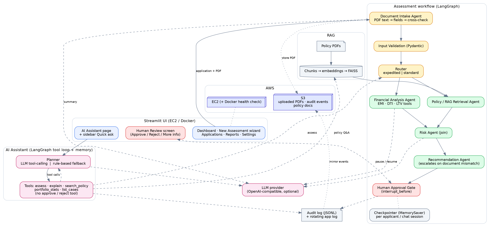
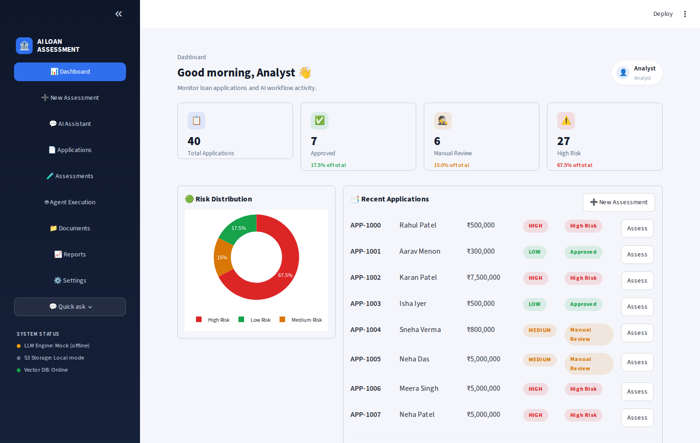
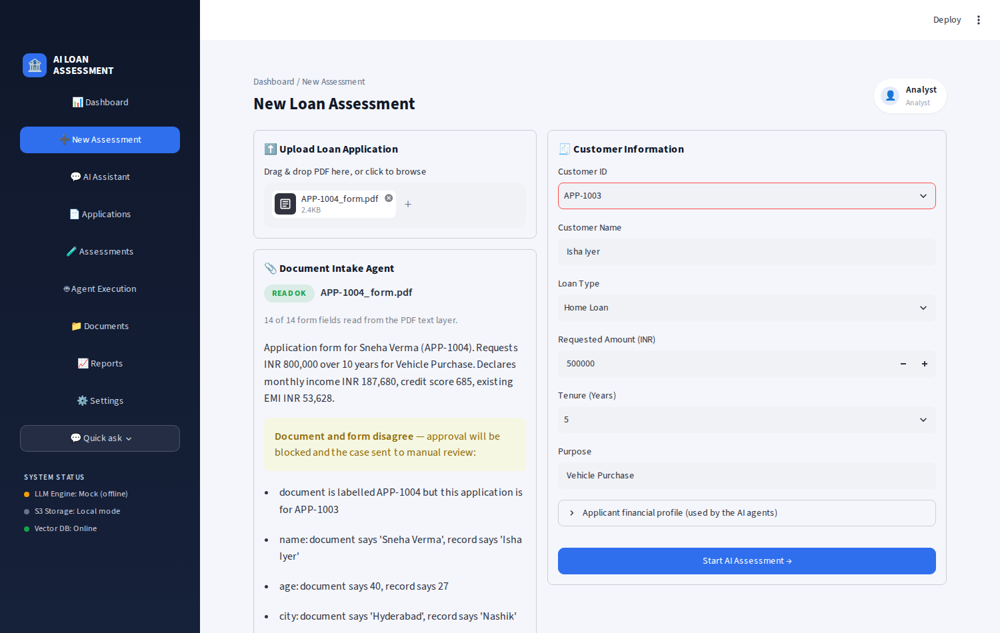
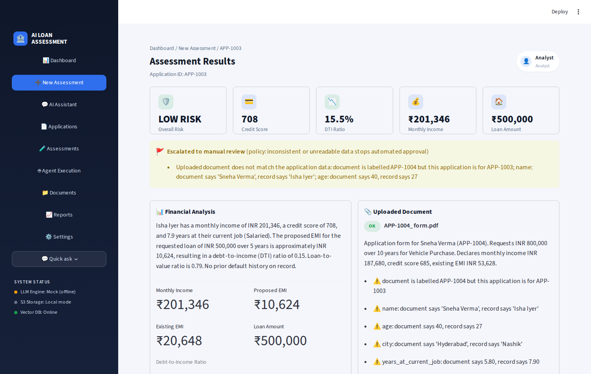
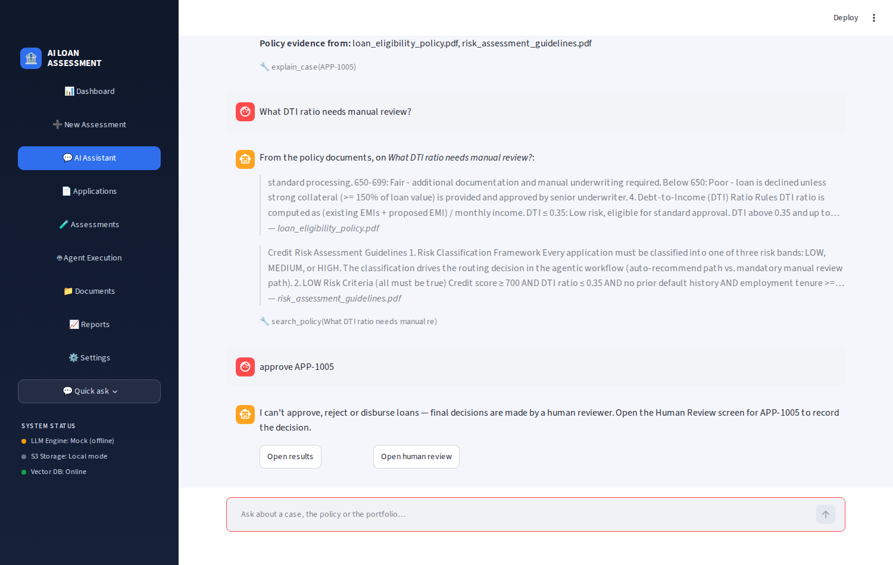

# AI Loan Eligibility Assessment Assistant

**Capstone Project — Theme 11 (Finance)** · Advanced PG Certification in AI Engineering on Cloud and AIOps

A multi-agent loan-assessment console. A loan officer uploads an application PDF, agents read it,
check it against the bank's policy documents (RAG), classify risk and recommend an outcome, and a
**human reviewer always makes the final decision**. A chat assistant answers questions about cases,
policy and the portfolio over the same backend.



## Screenshots

| | |
|---|---|
|  |  |
|  |  |

## What it does

| Area | Behaviour |
|---|---|
| **Document Intake Agent** | Reads the uploaded PDF's text layer (pypdf), parses the bank's standard application form into 14 typed fields, summarizes it, and cross-checks it against the entered/system data. Any mismatch, wrong-applicant document, or unreadable file **blocks auto-approval** and escalates to manual review (policy: `risk_assessment_guidelines.pdf` §5). |
| **Assessment workflow** (LangGraph) | `document_extraction → validate_input → router → [financial_analysis ‖ policy_retrieval] → risk_assessment (join) → recommendation → human approval gate → finalize` |
| **Router** | *Expedited* (small loan, high credit, no default) skips the LLM call in the Risk Agent; *standard* uses LLM + retrieved policy context. |
| **RAG** | Policy PDFs → chunks → embeddings → FAISS. Used by the Policy Retrieval agent and the assistant's policy Q&A. |
| **Human-in-the-loop** | `interrupt_before=["human_approval_gate"]`: the graph physically pauses until a reviewer chooses Approve / Reject / Request more info. |
| **AI Assistant** | Chat page + sidebar *Quick ask*. LangGraph tool loop with per-session memory. Tools: assess, explain, search policy, portfolio stats, list cases. **No approve/reject tool exists**; such requests are refused and pointed to Human Review. |
| **S3** | Uploaded PDFs, one object per audit event, and policy docs/forms (Settings → Sync). Circuit breaker: an S3 outage costs one timeout, not one per event. |
| **Validation, logging, audit** | Pydantic input validation, rotating log file, append-only JSONL audit trail (viewable in Settings). |
| **Dashboard** | Dashboard, New Assessment wizard, AI Assistant, Applications, Assessments, Agent Execution, Documents, Reports (PDF), Settings. |

### Two modes — know which one you are in

* **Mock / rule-based mode (default, no API key).** Everything works end to end, but the text is produced
  by templates and rules, not by a generative model. The sidebar and Assistant page say so.
* **LLM mode (`OPENAI_API_KEY` set).** The LLM writes the financial summary, the standard-route risk
  explanation, the recommendation text and the document summary, and **chooses the assistant's tools**.
  Approve/reject/recommend decisions themselves remain rule-based; the LLM explains, it does not decide.

## Verification status (what has and has not been proven)

| Claim | Evidence |
|---|---|
| Workflow, routing, parallel branches, human gate, validation, escalation | Automated tests (`pytest tests/`), including UI tests that drive the real Streamlit app |
| Document parsing | Parsed output compared field-by-field with the JSON each PDF was generated from; scanned/corrupt/unrelated PDFs fail with a clear reason |
| Risk-rule boundaries | Boundary tests (found and fixed a gap where DTI 35–36% and tenure < 6 months were misclassified LOW) |
| S3 integration | Tested against `moto` (in-process AWS simulator) incl. bucket auto-create, audit mirroring, sync, and an outage scenario. **Not tested against a real AWS account or LocalStack.** |
| LLM request/tool-calling path | Exercised through the real `openai` client against a scripted local OpenAI-compatible server (tool selection, unknown-tool refusal, malformed arguments, loop cap, outage fallback). **Never run against the real OpenAI service; answer quality is unevaluated.** |
| Docker | Dockerfile/compose written; the health-check command was verified against a live Streamlit server. **The image has not been built here** (no Docker in the dev sandbox). |
| AWS deployment | **Not deployed.** `deployment/ec2_deploy_steps.md` documents how. |

## Quick start

Tested with **Python 3.12**; dependencies are pinned.

```bash
python3 -m venv venv && source venv/bin/activate
pip install -r requirements.txt

cp .env.example .env              # optional: set OPENAI_API_KEY for LLM mode
python data_generation/generate_synthetic_data.py   # 40 applicants, 40 form PDFs, 2 policy PDFs
python -m rag.ingest                                 # build the FAISS index
streamlit run app.py                                 # http://localhost:8501
```

Try it:
1. **New Assessment** → pick `APP-1003`, upload `data/applications/APP-1004_form.pdf` (a different person's form)
   → the Document Intake card flags the mismatch → *Start AI Assessment* → the case is escalated to manual review.
2. **AI Assistant** → *Assess APP-1005* → *why was it flagged? and its DTI?* → *Open human review*.
3. Ask *approve APP-1005* to see the refusal.

Tests: `pip install -r requirements-dev.txt && pytest tests/ -v` (offline; no keys needed).
Graphviz is **not** required (diagrams render in the browser).

## Docker / AWS

```bash
cp .env.example .env && docker compose up --build     # app + LocalStack S3 at http://localhost:8501
```
EC2 + S3 deployment, the least-privilege IAM policy and verification commands:
[`deployment/ec2_deploy_steps.md`](deployment/ec2_deploy_steps.md).
On EC2 with an instance role set `S3_USE_INSTANCE_ROLE=1`; check with `python -m utils.s3_storage`.

## Repository layout

```
app.py                      Streamlit entry point / routing
ui/                         theme, components, pages (all screens), PDF report, workflow diagram
agents/
  document_agent.py         PDF → fields → cross-check → summary
  financial_agent.py        EMI / DTI / LTV tools + summary
  risk_agent.py             policy retrieval (parallel branch) + risk classification (join)
  recommendation_agent.py   APPROVE / REJECT / REFER_FOR_MANUAL_REVIEW
  chat_agent.py             assistant: LangGraph tool loop, LLM planner + rule-based planner, memory
  chat_tools.py             the assistant's tools (no decision tool)
  llm_client.py             OpenAI-compatible client: retries, timeout, mock mode, tool-calling
workflow/                   LangGraph state + graph (parallel fan-out/join, interrupt, checkpointer)
rag/                        ingest + retriever (FAISS; offline TF-IDF/SVD embeddings or OpenAI)
utils/                      schemas (Pydantic), audit_log, logging_config, s3_storage, portfolio, insights
data_generation/            synthetic applicants, form PDFs, policy PDFs
deployment/ · docker-compose.yml · .github/workflows/tests.yml
tests/                      backend, documents, S3 (moto), assistant (fake OpenAI server), UI (AppTest), rules
```

## Known limitations

* **State is in memory.** The LangGraph checkpointer and the case registry live in the app process, so a
  case paused for human review is lost on restart, and all browser sessions share one process (single-user
  demo, no authentication). Audit events and uploaded files do persist (disk, and S3 when configured).
  Production would use a durable checkpointer (PostgreSQL/DynamoDB) and SSO.
* **No OCR.** Only PDFs with a text layer in the standard form layout are parsed; others fail clearly.
* **Decisions are rule-based.** The LLM explains and summarizes; thresholds come from the synthetic policy PDFs.
* **Dashboard counts** are a rule-based pass over synthetic data, not agent results. The *Assessments* page
  lists only cases finalized in the current browser session.
* **Small RAG corpus** (2 PDFs, 8 chunks) and, by default, TF-IDF embeddings — retrieval quality is limited.
* **`langchain-community`** (PyPDFLoader, FAISS wrapper) is being sunset upstream; a migration to
  standalone packages is future work.
* All data is synthetic; no real customer or bank data is used.

## RFP Section 7 mapping

| Requirement | Where |
|---|---|
| Generative AI | `llm_client.py` (summaries/explanations/assistant, LLM mode) |
| Agentic workflows / multi-agent orchestration | `workflow/graph.py`, `agents/` |
| Sequential **and** parallel execution | financial ‖ policy retrieval, joined at the Risk Agent |
| Router-based decisions | `router_node` (changes whether the LLM is called) |
| RAG | `rag/`, policy retrieval agent, assistant `search_policy` |
| Tool-using agents | EMI/DTI/LTV tools; the assistant's tool loop |
| Human-in-the-loop approval | `interrupt_before` gate + Human Review screen |
| Memory / context | LangGraph checkpointers (per applicant; per chat session) |
| Error handling / retries | Pydantic validation, tenacity retries + timeout, per-node capture, S3 circuit breaker |
| Cloud deployment on AWS | S3 integration implemented and tested against a simulator; EC2/Docker artifacts provided — **deployment itself is yours to perform** |
| Dashboard / frontend | Streamlit app |
